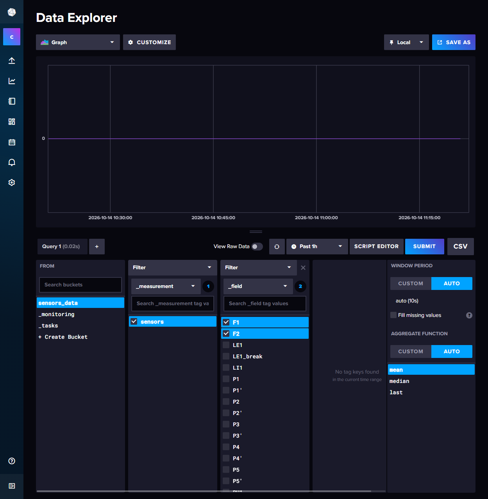
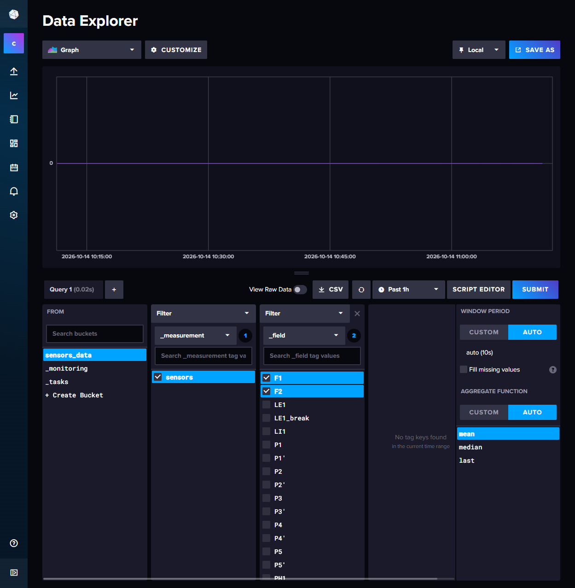

# InfluxDB CSV Export — 修复非安全上下文下消失的导出按钮

一个 Chrome MV3 扩展：当 InfluxDB 2.x 通过 `http://<局域网IP>:8086` 访问时，Data Explorer 里的 **CSV** 导出按钮会消失。本扩展把它加回来。

> Chrome extension (Manifest V3) that restores the missing Data Explorer **CSV** export button on InfluxDB instances reachable only over plain HTTP from a non-loopback origin.

> [!IMPORTANT]
> **本仓库当前是「钉死单实例」的定制版。** `manifest.json` 的 `matches` 只匹配 `http://169.254.197.198:8086/*`，换 IP 或换实例后扩展**完全不生效**（连 content script 都不会注入）。改动点与做法见 [本地定制说明](#本地定制说明)。

---

## 问题

InfluxDB 2.x 的 Data Explorer（`/orgs/<org>/data-explorer`）在打开 **View Raw Data** 后，工具栏上应该有一个 **CSV** 按钮，用来把查询结果导出成 CSV。但通过局域网地址访问时，这个按钮**根本不渲染**：

| 访问方式 | `View Raw Data` 旁是否有 CSV 按钮 |
| --- | --- |
| `http://127.0.0.1:8086` | 有 |
| `http://169.254.197.198:8086`（局域网 IP） | **没有** |

这**与 InfluxDB 版本无关，也与操作系统无关** —— 同一个服务端、同一个数据库、同一份 UI 产物，只是地址栏里的 origin 不同。



*`http://169.254.197.198:8086`：原生按钮不存在，最右侧的 `CSV` 是本扩展注入的。*



*`http://127.0.0.1:8086`（SSH 隧道指向同一实例）：原生 `CSV` 按钮正常出现。*

## 原因

按钮的渲染条件是一个叫 `browserSupportsDownload` 的 state，它完全由 **ServiceWorker 注册结果**决定。InfluxDB 2.8.0 的 Data Explorer 产物里可以读到：

```js
// .../5d599ef646.js
class c extends PureComponent {
  constructor(e) {
    super(e);
    this.state = { browserSupportsDownload: false };
    e.workerRegistration && e.workerRegistration.then(
      e => "activated" == e.active.state
        ? this.setState({ browserSupportsDownload: true })
        : console.error("Feature not available, because ServiceWorker is registered but inactive."),
      e => console.error("Feature not available, because ServiceWorker registration failed: ", e)
    );
  }
  render() {
    return this.state.browserSupportsDownload
      ? <Button text="CSV" icon={Download_New} onClick={this.handleClick} testID="csv-download-button" />
      : null;   // ← 非安全上下文永远走这里
  }
}
```

而 **Chrome 只在「安全上下文」(secure context) 中暴露 `navigator.serviceWorker`**。`http://localhost`、`http://127.0.0.1` 以及任何 HTTPS 都算安全上下文；**`http://<局域网IP>` 不算**。

于是在局域网 IP 上：ServiceWorker 注册直接失败 → `browserSupportsDownload` 永远是 `false` → `render()` 返回 `null` → 按钮不存在。同一个浏览器、两个 origin 实测：

| | `http://169.254.197.198:8086` | `http://127.0.0.1:8086` |
| --- | --- | --- |
| `window.isSecureContext` | `false` | `true` |
| `navigator.serviceWorker` | **不存在** | 存在 |
| 原生 CSV 按钮 | 无 | 有 |

> 想复现这个对照，需要让两个 origin 指向**同一个** InfluxDB 实例，例如 SSH 隧道：
> `ssh -L 127.0.0.1:8086:169.254.197.198:8086 user@169.254.197.198`
> 这样唯一的变量就只剩 origin。

> **常见误解**：网上（例如 influxdata/influxdb#24364）把这类现象归因为「Windows 版有、Linux 版没有」。实测不成立 —— 把 InfluxDB 2.8.0 的 Windows 版和 Linux 版 UI 产物逐文件比对，`index.html` 引用同一个 `/64a6202951.js`，30 个 chunk 的 SHA-256 **全部一致**（约 10.5 MB，0 处差异）。真正的变量是访问地址，不是操作系统。

## 工作原理

关键点：**安全上下文的限制只作用于 ServiceWorker 注册**，并不影响 `fetch`、`Blob`、`URL.createObjectURL` 和 `<a download>`。所以本扩展完全不需要 ServiceWorker，自己取数、自己存盘即可。

1. **`inject.js`（页面主世界）** — hook `window.fetch` 和 `XMLHttpRequest`，把 InfluxDB UI 自己发出的 `POST /api/v2/query` 请求（URL + body）通过 `postMessage` 交给 content script。这跟原生 ServiceWorker 做的事是同一个思路。
2. **`content.js`（隔离世界）** — 把 `CSV` 按钮插进 `[data-testid="time-machine--bottom"]` 工具栏里**原生按钮所在的同一个位置**（`View Raw Data` 右侧、自动刷新下拉框 `.autorefresh-dropdown` 之前），并复刻原生的外观：`cf-button-sm` 尺寸 + `cf-icon Download_New` 图标 + `cf-button--label` 文字。点击时用捕获到的 body 重放同一个查询：
   ```js
   fetch(url, {
     method: 'POST',
     credentials: 'include',
     headers: { 'Content-Type': 'application/json', 'Accept': 'text/csv' },
     body: lastQuery.body
   })
   ```
   同源请求会自动带上会话 cookie，所以 `influxdb-oss-session` 即使是 `HttpOnly` 也没问题 —— 不需要读取它。
3. **存盘** — `new Blob([text], { type: 'text/csv' })` → `URL.createObjectURL` → `<a download="query.csv">`。

> 原生实现在服务端还依赖 `Prefer: return-download` 请求头。在 InfluxDB **2.8.0 OSS** 上实测该头**没有任何作用**：加与不加，响应头（`Content-Type: text/csv; charset=utf-8`、无 `Content-Disposition`）和字节数完全一致，CSV 本来就是 `POST /api/v2/query` 的默认返回。所以本扩展不需要它。

## 安装

### 手动加载（推荐）

1. 打开 `chrome://extensions/`
2. 打开右上角的 **开发者模式**
3. 点 **加载已解压的扩展程序**，选择**本仓库根目录**（即含 `manifest.json` 的那一层）

> 实测（Chrome 154 / Windows）：命令行的 `--load-extension` 不会加载扩展，请用上面的 `chrome://extensions/` 手动加载。
> 自动化场景可以走 CDP：用 `--enable-unsafe-extension-debugging` 启动 Chrome，再调用 `Extensions.loadUnpacked`（`path` 指向本仓库根目录）。

## 使用

1. 打开 InfluxDB 的 Data Explorer 页面
2. 正常组查询（选 bucket / measurement / fields …）
3. 点一次 **SUBMIT**
4. 点 `View Raw Data` 右侧的 **CSV** 按钮（带下载图标，位置与原生按钮一致）→ 浏览器下载 `query.csv`

第 3 步是必需的：扩展要先「看到」一次查询请求才能重放它。在此之前点按钮会提示 `CSV: run a query first`。

按钮状态会实时反馈：`CSV …`（导出中）→ `CSV ✓`（成功）/ `CSV failed`（失败，鼠标悬停可看原因）。

## 验证

在目标页面的 DevTools Console 里可以直接确认：

```js
window.isSecureContext                                            // false → 就是本扩展要解决的场景
document.querySelector('[data-testid="csv-download-button"]')     // null   → 原生按钮确实不存在
document.getElementById('influx-csv-export-ext')                  // <button> → 扩展注入成功
document.documentElement.getAttribute('data-influx-csv-ext')      // "1"    → content script 已注入
```

在 `http://169.254.197.198:8086`（原生按钮缺失）上实测通过：

- `nativeCsv: false`、`extCsv: true`
- 点击后导出 **722 行 / 73,174 字节**，`_measurement=sensors`、`_field` 含 `F1` 与 `F2`
- 与在 `http://127.0.0.1:8086` 上点**原生**按钮得到的文件**结构完全一致**

（两者 SHA-256 不同是正常的：查询用的是「Past 1h」，两次 SUBMIT 相隔约 10 分钟，`_start` 随之前移，时间戳整体平移。示例文件见 [`docs/sample-export.csv`](docs/sample-export.csv)。）

## 已知限制

- **必须先点一次 SUBMIT**。扩展靠嗅探 UI 自己发出的查询请求来获知 Flux 语句；要「进页面即可导出」，需要改成从 Script Editor / Redux store 里取查询。
- **重放的是当时的时间范围**。捕获到的 body 里 `extern` 含已解析的绝对时间，所以导出的是「当时那次查询」的结果，而不是「重新查最近 1 小时」。需要后者就得自己重建 `range()`。
- **大结果集全量进内存**（原生是流式下载）。数据量很大时建议改用 `chrome.downloads` + 流式写入。
- **`matches` 已钉死在单个实例**。当前只匹配 `http://169.254.197.198:8086/*`，换 IP / 换实例后扩展**完全不生效**（连 content script 都不会注入）。改法见 [本地定制说明](#本地定制说明)。`content.js` 内部仍保留 InfluxDB 特征检测（meta description / title），并在原生按钮已存在时主动让位不重复注入。
- **依赖 InfluxDB 的 DOM test id**（`time-machine--bottom`、`csv-download-button` 等）。已在 2.8.0 验证；其他大版本可能不同。
- **不支持 InfluxDB Cloud / HTTPS 之外的鉴权差异**：本扩展只复用页面自身的会话；若实例要求 token 而非 cookie，需要另行处理。

## 备选方案

如果你的目的只是「拿到 CSV」，下面两个办法都不需要装扩展：

1. **走本地回环访问**。`http://127.0.0.1:8086` 是安全上下文，原生按钮直接可用。远端实例可以用 SSH 隧道映射过来：
   ```bash
   ssh -L 127.0.0.1:8086:<influx-host>:8086 user@<influx-host>
   ```
2. **让 Chrome 信任该 origin**（临时方案）：
   ```
   chrome.exe --user-data-dir="<非默认配置目录>" \
              --unsafely-treat-insecure-origin-as-secure=http://169.254.197.198:8086
   ```
   实测有效：`.198` 上 `isSecureContext` 变为 `true`，**原生** CSV 按钮出现。但必须同时指定非默认的 `--user-data-dir`，否则参数会被忽略；且它会全局降低该 origin 的安全级别，不建议长期使用。

## 目录结构

```
.
├── manifest.json                  # MV3 清单；matches 已钉到 169.254.197.198:8086
├── content.js                     # 隔离世界：注入嗅探器、加按钮、重放查询、存盘
├── inject.js                      # 页面主世界：hook fetch/XHR，捕获 /api/v2/query
├── docs/
│   ├── screenshot-with-extension.png    # 局域网 IP：原生缺失，扩展补上
│   ├── screenshot-native-127.0.0.1.png  # 回环地址：原生按钮正常
│   └── sample-export.csv                # 扩展导出的真实样例（722 行）
├── .gitattributes                 # 换行归一化；png/csv 按二进制处理
├── .gitignore
└── README.md
```

## 本地定制说明

相对通用版本，本仓库在 `manifest.json` 与 `content.js` 上各做了一处定制（即工作区中尚未提交的改动）。

### 1. `manifest.json` — 把生效范围钉到单个实例

```diff
   "content_scripts": [
     {
-      "matches": ["http://*/*", "https://*/*"],
+      "matches": ["http://169.254.197.198:8086/*"],
       "js": ["content.js"],
       "run_at": "document_idle",
       "all_frames": false
     }
   ],
   "web_accessible_resources": [
     {
       "resources": ["inject.js"],
-      "matches": ["http://*/*", "https://*/*"]
+      "matches": ["http://169.254.197.198:8086/*"]
     }
   ]
```

**两处必须一起改。** 只改 `content_scripts.matches` 的话：content script 能注入，但它去加载 `chrome-extension://…/inject.js` 时会被 `web_accessible_resources.matches` 挡掉，主世界嗅探器装不上 —— 表现是按钮能出现，但点下去永远提示 `CSV: run a query first`。

换到别的实例，把地址替换成目标即可：

```json
"matches": ["http://192.168.1.50:8086/*"]
```

要同时支持多个地址就写成数组：

```json
"matches": ["http://169.254.197.198:8086/*", "http://127.0.0.1:8086/*"]
```

改完在 `chrome://extensions/` 里点该扩展的「刷新」按钮（或重新「加载已解压的扩展程序」）。

> 已实测：Chrome 154 接受带端口的 match pattern，`http://169.254.197.198:8086/*` 在该地址上能正常匹配并注入（`html[data-influx-csv-ext]="1"`，按钮出现）。端口在 match pattern 中的精确匹配语义（是否等价于「该主机的任意端口」）未单独验证。

### 2. `content.js` — 按钮外观与位置对齐原生

```diff
+    const autoRefreshBtn = document.querySelector('.autorefresh-dropdown');
     var btn = document.createElement('button');
     btn.id = BUTTON_ID;
     btn.type = 'button';
-    btn.textContent = 'CSV';
+    btn.innerHTML = '<span><span data-testid="icon" class="cf-icon Download_New cf-button-icon"></span><span class="cf-button--label">CSV</span></span>';
-    btn.title = 'Download query results as a .CSV file (added by extension)';
+    btn.title = DEFAULT_TITLE;
     btn.setAttribute('data-testid', 'csv-download-button-ext');
-    btn.className = 'cf-button cf-button-md cf-button-default';
+    btn.className = 'cf-button cf-button-sm cf-button-default';
     btn.style.cssText = 'margin-left:8px;cursor:pointer;';
     btn.addEventListener('click', function () { exportCsv(btn); });
-    bar.appendChild(btn);
+    bar.insertBefore(btn, autoRefreshBtn);
```

- 用 `cf-icon Download_New` + `cf-button--label` 复刻原生按钮的「图标 + 文字」结构，尺寸由 `md` 改为 `sm`
- 插入点由工具栏末尾（`appendChild`）改为 `.autorefresh-dropdown` **之前**，即落在 `View Raw Data` 右侧、刷新控件左侧 —— 与原生 CSV 按钮同位置
- 查不到 `.autorefresh-dropdown` 时 `insertBefore(btn, null)` 等价于 `appendChild`，会退回追加到末尾，不会抛错
- 标题字面量提成 `DEFAULT_TITLE` 常量，供后面状态恢复时复用

在 `http://169.254.197.198:8086` 上实测：

```
extClass : "cf-button cf-button-sm cf-button-default"
extHtml  : "<span><span data-testid=\"icon\" class=\"cf-icon Download_New cf-button-icon\"></span><span class=\"cf-button--label\">CSV</span></span>"
barOrder : [div, influx-csv-export-ext, div, div, switch-to-script-editor, time-machine-submit-button]
```

`barOrder` 里 `influx-csv-export-ext` 排第 2 位，正好夹在 `View Raw Data` 与自动刷新控件之间，符合预期。

### 3. `content.js` — 状态更新只改 label（修复图标丢失）

把上面「外观改版」和原有的状态反馈接上以后暴露出一个缺陷：`exportCsv()` 原本用 `btn.textContent = 'CSV …'` / `'CSV ✓'` / `'CSV failed'` 反馈状态，而给 `textContent` 赋值会**清空 `innerHTML`**，把那段图标标记一起抹掉。修复前实测：

```
点击前 extHtml: "<span><span ... class=\"cf-icon Download_New ...\"></span><span class=\"cf-button--label\">CSV</span></span>"
点击后 extHtml: "CSV"        ← 图标永久丢失
```

而且恢复用的 `var old = btn.textContent` 记下的也只是 `"CSV"`，所以退化成纯文字后再也回不来。

修法是让状态更新只动 label 节点：

```diff
+  // Only ever rewrite the label node. Assigning to btn.textContent would wipe
+  // out the icon markup that ensureButton() builds.
+  function setLabel(btn, text) {
+    var label = btn.querySelector('.cf-button--label');
+    if (label) label.textContent = text;
+    else btn.textContent = text;
+  }
+
   function exportCsv(btn) {
     if (!lastQuery) {
-      btn.textContent = 'CSV: run a query first';
-      setTimeout(function () { btn.textContent = 'CSV'; }, 2500);
+      setLabel(btn, 'CSV: run a query first');
+      setTimeout(function () { setLabel(btn, 'CSV'); }, 2500);
       return;
     }
@@
     btn.disabled = true;
-    var old = btn.textContent;
-    btn.textContent = 'CSV \u2026';
+    setLabel(btn, 'CSV \u2026');
@@
-      btn.textContent = 'CSV \u2713';
-      setTimeout(function () { btn.textContent = old; btn.disabled = false; }, 2000);
+      setLabel(btn, 'CSV \u2713');
+      setTimeout(function () {
+        setLabel(btn, 'CSV');
+        btn.disabled = false;
+      }, 2000);
     }).catch(function (err) {
-      btn.textContent = 'CSV failed';
+      setLabel(btn, 'CSV failed');
       btn.title = String(err);
-      setTimeout(function () { btn.textContent = old; btn.disabled = false; }, 3000);
+      setTimeout(function () {
+        setLabel(btn, 'CSV');
+        btn.title = DEFAULT_TITLE;
+        btn.disabled = false;
+      }, 3000);
     });
```

顺带把失败时被改写的 `btn.title` 也还原回 `DEFAULT_TITLE`，否则错误信息会一直挂在按钮上。

修复后在 `http://169.254.197.198:8086` 上实测（点击前 → 点击后 → 状态定时器走完）：

```
iconPresent : true → true → true
labelText   : "CSV" → "CSV" → "CSV"      （中间短暂显示 "CSV …" / "CSV ✓"）
extHtml     : 点击前后完全一致，图标标记没丢
导出结果     : Downloads\query.csv，73,174 字节 / 722 行
```

## 开发笔记

- 扩展**没有** background service worker，也没有任何网络权限声明：所有请求都从页面自身 origin 发出，靠 `credentials: 'include'` 复用页面会话。
- 调试时关注两处 DOM 标记：`html[data-influx-csv-ext="1"]`（content script 已注入）与 `#influx-csv-export-ext`（按钮已创建）。`inject.js` 通过 `<script src="chrome-extension://…">` 注入主世界；InfluxDB 页面未设置 CSP，因此不会被拦（若目标实例设置了 CSP，可改用 `chrome.scripting.executeScript({ world: 'MAIN' })`）。
- 主世界脚本用 `window.__influxCsvExportHooked` 做幂等保护，重复注入不会叠加 hook。

## 测试环境

- Chrome 154.0.8037.99（Windows）
- InfluxDB v2.8.0 OSS，commit `40a633239e`，UI 前端 `5c07739`
- 未在 InfluxDB 1.x / 3.x、InfluxDB Cloud 上验证

## 许可证

尚未指定。如需开源请补充 `LICENSE`（例如 MIT）。
